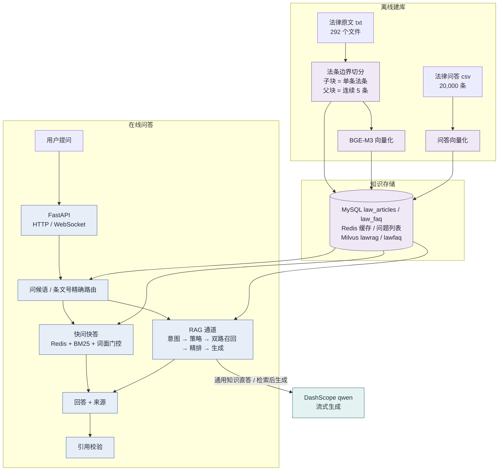
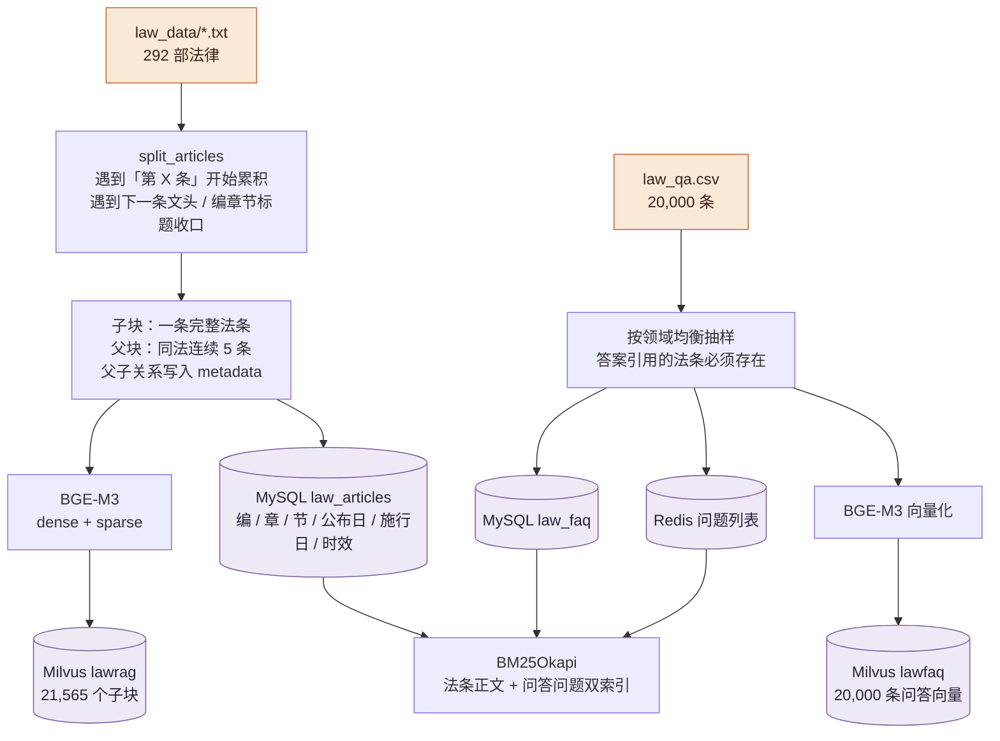
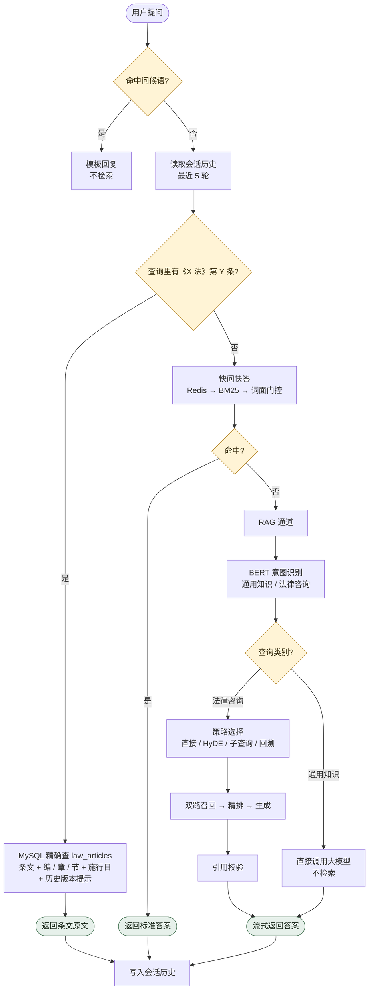
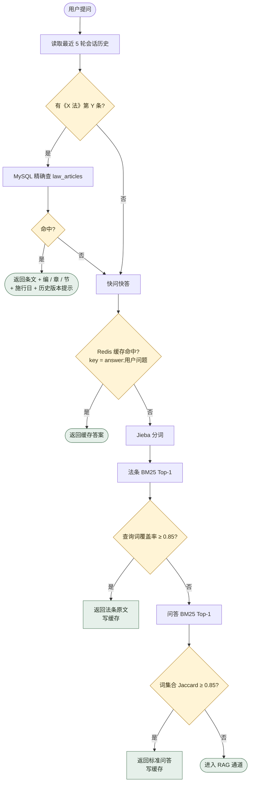
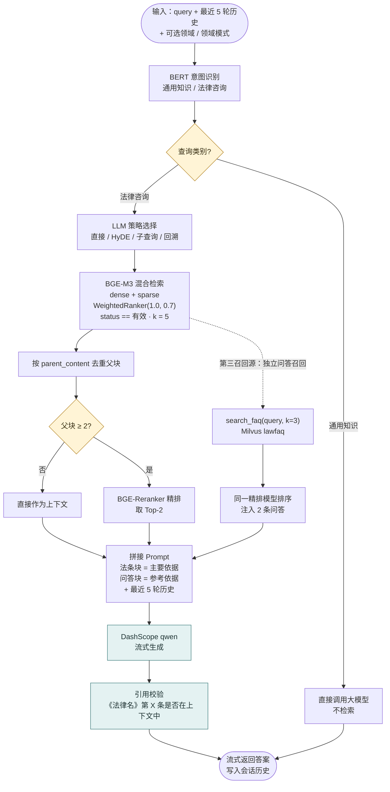
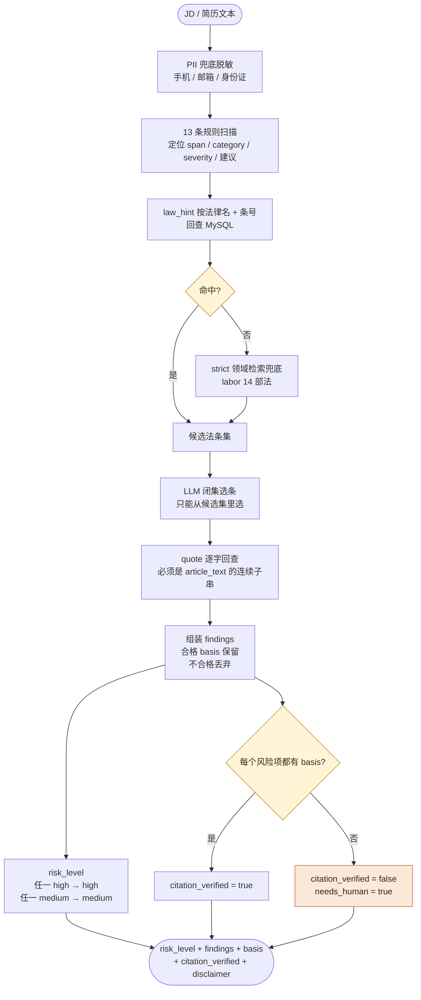
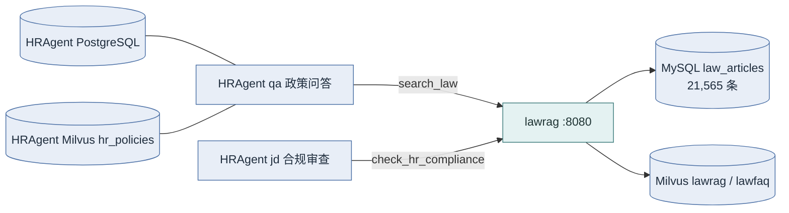

# LexRAG 项目介绍

> 法规检索与合规取证引擎。仓库名 `lawrag` 为历史命名，代码、Milvus 集合与镜像名保持不变。
> 一个中文法律领域的 RAG 问答与合规检查服务。能精确命中的问题走确定性通道，其余问题走「法条 + 问答双召回 → 精排 → 大模型生成」的 RAG 通道；回答必须标注《法律名》第 X 条，生成后再做一次引用校验。

---

## 一页速览

| 项 | 内容 |
|---|---|
| 项目定位 | 中文法律 RAG 问答 + HR 合规检查，作为独立法规知识层给上层 Agent 提供证据 |
| 语料规模 | 292 个法律文件，21,565 条法条（现行有效 21,312 条），20,000 条法律问答 |
| 三条通道 | 条文号精确路由 → 快问快答（Redis + BM25 + 词面门控）→ RAG 检索增强 |
| 核心模型 | BGE-M3（dense + sparse）、BGE-Reranker-large、BERT 意图分类、DashScope qwen |
| 存储 | MySQL 8（法条 / 问答 / 会话）、Redis（缓存 / 问题列表）、Milvus（法条 / 问答向量） |
| 对外接口 | HTTP（问答 / 检索 / 取条 / 合规检查）+ MCP 薄封装（4 个工具） |
| 关键指标 | 全量 Recall@5 0.901，MRR 0.7919，RAGAS 忠实度 0.8992，快通道错答 54 → 0，HR 合规 P/R/F1 = 1.0 |
| 边界 | 只覆盖全国人大及其常委会制定的法律级文本；不提供个案结论，不替代律师 |

---

## 1. 这个项目在做什么

法律问答和普通文档问答不一样，难点主要有四个：

1. **法条不能按固定长度切**。按 500 字切分，很容易把一条法条从中间切断，检索到「半条法条」，引用就不准。
2. **用户经常直接问「第 X 条」**。这类问题应该走精确查询，不需要向量检索，也不应该让模型去猜。
3. **库内原句和真实用户问题的表述差异很大**。快问快答如果只看向量相似度，很容易把「看起来很像、结论不同」的问题直接抢答。
4. **模型生成的条文号可能是编的**。法律场景里，编一个不存在的条号比回答「不知道」危险得多。

LexRAG 把问题拆成三层处理：

- **能精确命中的**：查询里带《法律名》第 X 条，直接查 MySQL；
- **能词面命中的**：库内原句或同一个问题，走 Redis + BM25 + 词面门控；
- **其余问题**：走 RAG，先检索法条和问答，再精排、生成、校验引用。

此外，它把「HR 合规检查」做成了一个独立的证据型接口：规则负责定位风险片段，法条只从库里回查，LLM 只能从候选集里选条，不能自己编条号。

**一句话概括：把「确定性检索」放在「语义生成」前面，把「可回查的证据」放在「流畅的回答」前面。**

---

## 2. 核心思想

### 2.1 确定性优先，语义兜底

**一句话**：能精确查到的问题，绝不交给向量检索去猜；只有查不到时，才进入 RAG。

**为什么**：用户问「《劳动合同法》第十九条讲什么」，答案就在 MySQL 里。走向量检索不仅慢，还可能召回一条相似但不相关的法条。确定性查询的正确率是 100%，没有理由不用。

**怎么做**：

- 第一层：问候语正则，直接模板回复，不检索；
- 第二层：条文号精确路由，命中《X 法》第 Y 条就查 MySQL；
- 第三层：快问快答，Redis 缓存 → BM25 → 词面门控；
- 第四层：RAG，意图识别 → 策略选择 → 双路召回 → 精排 → 生成。

**代价**：路由逻辑比「所有问题都走 RAG」复杂，需要维护多套通道和门控参数。但换来的是延迟和成本下降、正确率提升。

### 2.2 法条不能按字数切

**一句话**：子块是一条完整法条，父块是同一部法律连续 5 条；父子关系写在 metadata 里。

**为什么**：法条是天然的最小自包含单元。按字数切分会把「第 X 条」切成两半，检索到前半句，模型就可能基于不完整的条文回答。

**怎么做**：

- 解析法律原文时，遇到「第 X 条」开始累积，遇到下一条文头或编章节标题收口；
- 子块 = 一条完整法条，用于精确检索和引用；
- 父块 = 同法连续 5 条，用于给模型提供上下文；
- 检索命中子块后，按 `parent_content` 去重回父块，再精排。

**代价**：需要自己写法条解析器和切分器，不能直接用通用的递归切分。但这是法律 RAG 的地基——早期版本 50.2% 的法条正文不完整，修复后正文覆盖率从 53.54% 提升到 100%。

### 2.3 快通道用词面判据，不用向量分

**一句话**：只有「查询本身就是这条法条」或「就是同一个问题」，才允许秒回。

**为什么**：向量相似度高，不代表结论相同。「试用期最长多久」和「试用期可以随便延长吗」在向量空间里可能很近，但后者需要分析，不能直接返回前者的标准答案。早期用「全库 softmax 分 > 0.85」做门控，语料扩容后真实法律问题有 90% 被抢答，其中约一半答错。

**怎么做**：

- 法条通道看**查询词覆盖率**：查询里的词有多少出现在候选法条正文里，`≥ 0.85` 才命中；
- 问答通道看**词集合 Jaccard**：查询和库内问题的词集合重合度，`≥ 0.85` 才命中；
- 阈值由 `tools/tune_fast_channel_gate.py` 标定：正样本是库内原句 200 条，负样本是真实法律问题 100 条。

**代价**：一部分本来可以秒回的问题会进入 RAG，延迟变高。但调参后错误抢答从 54 条降到 0，真实法律问题进入 RAG 的比例从 10% 提升到 99%——这是有意的取舍：宁可慢一点，也不能答错。

### 2.4 时效是硬过滤，不是排序加权

**一句话**：检索常开 `status == "有效"`，已废止或旧版本的法条不进入正常问答。

**为什么**：语料里保留 4 部历史版本做新旧对照，但用户问的是「现在怎么规定」。如果检索把已废止的条文排到前面，即使排序分很高，答案也是错的。

**怎么做**：

- Milvus 的 `lawrag` 集合有 `status` 标量字段；
- `search_children` 默认加 `status == "有效"` 过滤；
- 条文号精确路由命中历史版本时，会在回答里明确提示「版本状态」；
- 评测里保留 `effective_only=False` 的对照组，用来观察时效过滤的代价。

**代价**：正常问答检索不到历史版本；做新旧对照时需要显式关闭过滤或走专门的接口。

### 2.5 引用必须能回查

**一句话**：回答里的《法律名》第 X 条，必须能在本轮检索到的上下文里找到；找不到就提示，不假装有依据。

**为什么**：法律场景最常见的幻觉就是编条文号。模型可以写出「根据《劳动合同法》第九十九条」，但这条可能根本不存在，或者内容和问题无关。

**怎么做**：

- `citation_check.py` 用正则抽取回答里的《法律名》第 X 条，统一全称/简称和中文数字；
- 和本轮上下文里的引用做集合比对；
- 有未命中的引用时，在回答末尾追加校验提示，让用户谨慎采信；
- HR 合规更严格：`quote` 必须是 MySQL `article_text` 的连续子串，不通过就丢弃该 `basis`，并标 `needs_human=true`。

**代价**：校验是「条号存在性 + 引文回查」，不是 NLI 级别的语义蕴含判断；而且暂不识别「第 X 条之一」，只会漏检，不会误报。

### 2.6 合规场景闭集取证

**一句话**：规则只负责定位片段，条号只能来自库，LLM 只能从候选集里选，不能改片段、类别和严重程度。

**为什么**：合规结论是要给人看的，甚至是给法务看的。如果让 LLM 自由生成「依据」，它很容易编出一条听起来很合理的法条。正确做法是把「发现风险」和「找依据」拆开：规则发现风险，库提供候选，LLM 只做选择题。

**怎么做**：

- 13 条确定性规则扫描 JD / 简历文本，输出 `span`、`category`、`severity`、`suggestion`；
- 规则自带 `law_hint`，按「法律名 + 条号」回查 MySQL；回查失败才走 strict 领域检索兜底；
- LLM 从候选集里选条，不能改 `span` / `category` / `severity`；
- `quote` 逐字回查，不合格就丢弃 basis；
- `risk_level` 由代码聚合：任一 high → high，任一 medium → medium。

**代价**：13 条规则是召回上限，规则之外的歧视或违法表述可能漏检；命中项仍然需要人工复核。但每一条结论都能追到原文，这比「看起来很全」更重要。

---

## 3. 系统架构

### 3.1 总体架构

LexRAG 可以分成三块：离线建库、在线问答、评测闭环。离线建库负责把法律原文和问答数据变成可检索的索引；在线问答负责路由、检索和生成；评测闭环负责用固定评测集验证改动。

下面的架构图只画**离线建库 → 知识存储 → 在线问答**这条主链。评测闭环不在请求链路上，单独放在第 12 节讲。



几个要点：

- **离线建库和在线问答是分开的**。建库是一次性/低频任务，在线问答是高频请求；在线链路不会临时写索引。
- **法条和问答分别建 Milvus 集合**。法条集合有 `status` 字段，检索常开 `status == "有效"`；问答条目没有这个字段，如果混进同一个集合，会被整条过滤掉。
- **MySQL、Redis、Milvus 各司其职**：MySQL 存原文和结构化信息，Redis 存缓存和问题列表，Milvus 存向量。
- **评测闭环不是附属品**。每次改切分、检索、Prompt，都要用固定评测集回归，避免「感觉变好了」。

### 3.2 一次在线请求怎么走

以「试用期最长多久」为例：

1. 前端通过 `POST /api/query` 或 WebSocket `/api/stream` 发起请求；
2. `app.py` 先做问候语检查，不命中则进入 `new_main.py`；
3. 读取会话历史（最近 5 轮）；
4. 条文号精确路由：查询里没有《X 法》第 Y 条，跳过；
5. 快问快答：Redis 没命中 → 分词 → 法条 BM25 → 查询词覆盖率不够 → 问答 BM25 → Jaccard 不够；
6. 进入 RAG：BERT 判为「法律咨询」→ 策略选择「直接检索」→ 法条混合检索 + FAQ 召回 → 父块去重 → 精排 → 拼 Prompt → qwen 流式生成；
7. 引用校验：回答里的《法律名》第 X 条是否在本轮上下文里；
8. 写入会话历史，返回答案。

### 3.3 为什么法条和问答要分两个集合

这是建库时踩过的一个坑：

- `lawrag` 集合的检索表达式固定带 `status == "有效"`；
- `lawfaq` 的问答条目没有 `status` 字段；
- 如果把问答条目写进 `lawrag` 集合，检索时会被整条过滤掉，看起来「问答召回永远为空」。

所以问答单独建 `lawfaq` 集合，检索时走独立的 `search_faq`，不共享法条的时效过滤。

---

## 4. 离线建库

### 4.1 三条并行链路



三条链路共用同一份法条原文：

1. **RAG 法条向量库**：法条原文 → 解析出法律名 / 条号 / 正文 → 按法条边界切分 → 子块和父块 → BGE-M3 生成 dense + sparse 向量 → 写入 Milvus `lawrag`。
2. **结构化法条表 + 快问快答库**：法条写入 MySQL `law_articles`，带编/章/节、公布日、施行日、时效状态；20,000 条问答写入 `law_faq`，问题列表写入 Redis，构建法条和问答两套 BM25 索引。
3. **问答向量库**：`law_faq` 的 20,000 条问答用 BGE-M3 向量化，写入 Milvus `lawfaq`，作为 RAG 的第三召回源。

### 4.2 两个建库时必须注意的点

**第一，重建 `law_articles` 要先 TRUNCATE 再写。** 旧语料和新语料的条号会重号，如果只用 `INSERT IGNORE`，新数据会被静默跳过，库里的条数永远对不上。所以 `import_law_data.py` 会先清空再重写。

**第二，换语料后重建向量必须加 `--reset`。** 否则新旧块会混在同一个集合里，检索结果会莫名其妙地变差。

### 4.3 法条切分的修复

早期版本的切分器只保留「第 X 条」开头的那一行，把后面的枚举项和续行丢了，导致 50.2% 的法条正文不完整，正文覆盖率只有 53.54%。

修复后的规则是：

- 遇到「第 X 条」开始累积；
- 后续的续行、枚举项都拼回同一条；
- 遇到下一条文头或编/章/节标题才收口。

修复后正文覆盖率 100%，法条总数保持 21,565 条不变。全量 Recall@5 从 0.824 提升到 0.901，MRR 从 0.7188 提升到 0.7919——这个提升来自语料补全，不是调参。

---

## 5. 在线问答总流程

这张图是「一次提问会经过哪些判断」，细节通道在后面两节展开。



**三个关键判断点，也是这个项目最值得讲的设计：**

1. **问候语**：正则模板直接回，不触发任何检索。用户说「你好」，不需要查 21,565 条法条。
2. **条文号精确路由**：查询里出现《X 法》第 Y 条时走 MySQL 精确查，**确定性检索优先于语义检索**。
3. **快通道门控**：只有「查询本身就是那条条文」或「就是同一个问题」才允许秒回，其余一律交给 RAG。

**一个容易忽略的细节**：问候语、条文号路由、快通道都**不做领域过滤**。领域视图只作用于 RAG 检索链路。原因是这三个通道是确定性/词面命中，加领域过滤反而会让精确查询失效。

---

## 6. 通道一：条文号精确路由 + 快问快答

### 6.1 流程图



### 6.2 条文号精确路由

查询里出现《法律名》第 X 条时：

- 从查询中抽取法律名、条号、中文数字；
- 按「法律名 + 条号」直接查 MySQL `law_articles`；
- 返回条文原文，并带上编/章/节、施行日期；
- 如果库里另存历史版本，明确提示「以上引用的为现行有效版本，知识库另存有某年的旧版本」。

**为什么重要**：精确引用不该交给向量库去猜。模型不需要参与，答案就是原文。

### 6.3 快问快答

快问快答不是「向量相似度秒回」，而是两层词面判断：

| 层 | 数据源 | 判据 | 命中后 |
|---|---|---|---|
| 法条通道 | MySQL `law_articles` 的 BM25 | 查询词覆盖率 ≥ 0.85 | 返回法条原文，写 Redis |
| 问答通道 | MySQL `law_faq` 的 BM25 | 词集合 Jaccard ≥ 0.85 | 返回标准答案，写 Redis |

几个细节：

- **先查 Redis**：缓存 key 是 `answer:{用户问题}`，TTL 7 天；命中直接返回；
- **法条优先于问答**：法条通道先试，因为「查询本身就是条文」是最确定的情况；
- **门控用词面判据，不用 BM25 原始分或 softmax 分**：BM25 分数受语料规模影响，语料从 97 部扩到 292 部后，同一个分值代表的东西完全变了；
- **未命中就转 RAG**：快通道只负责「确定能答」的问题，不负责「猜」。

### 6.4 门控标定的结果

`tools/tune_fast_channel_gate.py` 用两组样本标定：

- 正样本：库内原句 200 条，应该秒回；
- 负样本：真实法律问题 100 条，不应该被快通道抢答。

调参后的结果：

- 错误抢答：54 条 → 0；
- 真实法律问题进入 RAG 的比例：10% → 99%；
- 库内原句仍然 200/200 秒回。

这说明门控没有「为了稳而全部转 RAG」，而是把「同一个问题」和「相似但不同的问题」分开了。

---

## 7. 通道二：RAG 检索增强

### 7.1 流程图



### 7.2 意图识别：通用知识还是法律咨询

先用 BERT 分类器（`bert_query_classifier_law`）做二分类：

- **通用知识**：例如「你好」「今天星期几」，直接调用大模型，不检索；
- **法律咨询**：进入 RAG 流程。

这一步的意义是省成本：不是所有问题都值得检索 21,565 条法条。

### 7.3 四种检索策略

法律咨询由 LLM 在四种策略里选一种：

| 策略 | 适用场景 | 做法 |
|---|---|---|
| 直接检索 | 问题指向明确 | 用原问题检索 |
| 假设问题检索（HyDE） | 问题比较抽象 | 先让模型写一段假设答案，再用假设答案检索 |
| 子查询检索 | 问题包含多个实体或方面 | 拆成多个子查询，分别检索后合并去重 |
| 回溯问题检索 | 问题很复杂，需要先简化 | 先把问题改写成更基础的问题，再检索 |

策略选择是一个 LLM 调用，失败时默认回退到「直接检索」。这样即使策略选择器挂了，主流程仍然可用。

### 7.4 检索与精排

**法条链路：**

1. BGE-M3 dense + sparse 混合检索，`WeightedRanker(1.0, 0.7)`；
2. 过滤 `source == "law"`、`status == "有效"`，返回 `k = 5` 个子块；
3. 按 `parent_content` 去重，得到父块；
4. 父块不足 2 条时直接返回；否则用 BGE-Reranker-large 精排，取 Top-2（`CANDIDATE_M = 2`）。

**问答链路（第三召回源）：**

1. `search_faq(query, k=3)` 从 `lawfaq` 集合召回；
2. 用同一个 BGE-Reranker 排序；
3. 最多注入 2 条问答（`FAQ_INJECT_N = 2`）。

**为什么问答要单独一路**：法条检索漏掉的条文，问答对常常能补上。实测接入第三召回源后，条文覆盖率从 65% 提升到 78.75%，拒答率从 24% 降到 5%。但提示词里必须明确「法条块是主要依据，问答块是参考依据」，否则模型会分不清两者的权重。

### 7.5 领域视图

`domain_profiles.json` 定义领域到法名列表的映射。当前只有 `labor`（劳动与 HR 合规），包含 10 部主法和 4 部补充法。

| 模式 | 行为 | 用途 |
|---|---|---|
| `off` | 不过滤，全量检索 | 默认 |
| `soft` | 先按领域法名过滤；父块不足 2 条时放开过滤重试 | HR 问答 |
| `strict` | 只按领域法名过滤，不兜底 | 合规取证 |

实现上只用了 Milvus 已有的 `law_name` 标量字段拼 `in` 过滤，不新增字段、不重建索引。领域是配置，不是代码分支。

### 7.6 Prompt 与引用校验

Prompt 由四部分组成：

1. **法条块**：检索到的父块，作为主要依据；
2. **问答块**：最多 2 条相似问答，作为参考依据；
3. **最近 5 轮历史**：保持多轮连贯；
4. **当前问题**。

Prompt 超过 4096 字符时截断。生成是流式的，每产生一个 token 就返回给前端；同时累积完整答案，生成结束后做引用校验：

- 抽取回答里的《法律名》第 X 条；
- 和本轮上下文里的引用做比对；
- 有未命中的引用，在回答末尾追加提示。

**注意**：引用校验只判断「条号是否出现在上下文里」，不是判断「这条法条是否真的支持这个结论」。它是防幻觉的底线，不是法律正确性的保证。

---

## 8. HR 合规检查

### 8.1 它解决什么

给一段 JD 或简历文本，找出就业歧视、违法条款、虚假承诺，并给出可回查的法条依据。它不是「法律意见」，而是「合规提示 + 证据」。

### 8.2 流程图



### 8.3 四条硬约束

1. **规则只负责定位，不产生条号**。规则输出的是 `span`、`category`、`severity`、`suggestion`，不输出「根据第 X 条」。
2. **条号只来自两个地方**：`law_hint` 的 MySQL 回查，或者 strict 劳动法领域的检索兜底。检索兜底只补 `law_hint` 回查失败的情况。
3. **LLM 只能做闭集选择**。它从候选集里选条，不能改 `span`、`category`、`severity`；超时 5 秒或解析失败时，自动回退到确定性 hint，接口仍然返回，只是 `llm_used=false`。
4. **`quote` 必须逐字回查**。去掉空白、统一全半角标点后，必须是 MySQL `article_text` 的连续子串；不通过就丢弃该 basis，并标 `needs_human=true`。

### 8.4 `citation_verified` 到底表示什么

- **干净文本**：没有风险项，`citation_verified=true`；
- **有风险项且每个都有 basis**：`true`；
- **有风险项但至少一个没有可回查的 basis**：`false`，同时该风险项 `needs_human=true`。

注意：`needs_human` 只表示「法条依据是否完成逐字回查」，**不代表法务结论**。命中项仍然需要人工复核。

### 8.5 13 条规则

规则集在 `rag_qa/data/compliance_rules.json`，与 HRAgent 侧保持同源。主要类别：

| 类别 | 例子 | 严重程度 |
|---|---|---|
| 就业歧视 | 限男性、35 岁以下、限户籍、限民族、限身高外貌 | high |
| 违法条款 | 试用期 9 个月、不缴社保、收取押金/扣身份证、违法工时 | high / medium |
| 虚假承诺 | 承诺无法保证的收益或结果 | medium |
| 表述不清 | 薪资面议等模糊表述 | medium |

每条规则自带 `law_hint`，例如「限男性」对应《就业促进法》第二十七条和《劳动法》第十二条。没有 `law_hint` 的规则（如「薪资面议」）不检索兜底，`basis` 留空并标 `needs_human`。

### 8.6 合规评测

140 条 JD 评测集：

- 80 条违规 / 40 条干净 / 20 条边界；
- 30 条沿用 HRAgent 已有样本，110 条按 13 类规则/边界模板生成并逐条核对；
- 拆分：dev 60（40 违规 / 15 干净 / 5 边界），test 80（40 违规 / 25 干净 / 15 边界）；
- 规则和 Prompt 只用 dev 调，test 只跑一次。

结果：规则轨 P/R/F1 = 1.0，引用准确率 100%，干净 JD 误报 0%。这组数字说明规则与取证链路一致，**不代表开放世界的合规准确率**。

---

## 9. 核心设计细节

### 9.1 法条切分与父子块

- **子块**：一条完整法条，用于精确检索和引用；
- **父块**：同一部法律连续 5 条，用于补齐上下文；
- **metadata**：`parent_id`、`parent_content`、`law_name`、`article_no`、`chapter`、`status`；
- 检索命中子块后，按 `parent_content` 去重，再对父块精排。

这样既能保证「引用的是完整法条」，又能让模型看到前后文。

### 9.2 快通道门控为什么不用向量分

向量相似度衡量的是「语义接近」，但快通道需要的是「同一个问题」。这两个不是一回事：

- 「试用期最长多久」和「试用期可以随便延长吗」语义接近，但后者需要分析，不能直接返回前者的答案；
- 库内原句和用户问题往往只差几个词，词面判据反而更准。

所以用法条通道的「查询词覆盖率」和问答通道的「Jaccard」，阈值 0.85，由脚本标定。

### 9.3 时效过滤

- `search_children` 默认加 `status == "有效"`；
- 语料保留 4 部历史版本做新旧对照，正常问答不返回；
- 条文号精确路由命中历史版本时，回答里会明确标「版本状态」；
- 评测保留 `effective_only=False` 对照组，观察过滤的代价。

### 9.4 领域视图

- `domain_profiles.json`：领域 → 法名列表 / FAQ domain；
- 检索时拼 `law_name in [...]`，不新增 Milvus 字段；
- `soft` 模式在父块不足 2 条时放开过滤，避免「聚焦变成漏答」；
- `strict` 模式不放开，用于合规取证。

### 9.5 引用校验

- `citation_check.py` 抽取《法律名》第 X 条；
- 统一全称/简称：「中华人民共和国」前缀去掉；
- 统一中文数字和阿拉伯数字；
- 和本轮上下文比对，未命中的引用追加提示；
- 暂不识别「第 X 条之一」，只会漏检，不会误报。

### 9.6 证据型工具接口

`/api/search_law`、`/api/get_article`、`/api/corpus_info`、`/api/check_hr_compliance` 都只返回结构化数据，不生成长文本。MCP 薄封装只调这些 HTTP 接口，不 import `app.py`，也不重复加载模型。

这样做的好处：

- 上层 Agent 拿到的是「条文 / 条号 / 引文 / 风险项」，不是一段无法核对的自然语言；
- MCP server 不需要 GPU 环境，只需要装有 `mcp` 的解释器；
- 合规检查可以单独部署、单独扩容。

---

## 10. 数据规模

| 数据 | 位置 | 规模 |
|---|---|---:|
| 法律原文 | `rag_qa/data/law_data/` | 292 个文件，288 部现行 + 4 个历史版本 |
| 法条表 | MySQL `law_articles` | 21,565 条（现行有效 21,312，历史版本 253） |
| 法条向量 | Milvus `lawrag` | 21,565 个子块 |
| 法律问答 | MySQL `law_faq` | 20,000 条 |
| 问答向量 | Milvus `lawfaq` | 20,000 条 |
| HR 合规评测 | `rag_qa/data/hr_eval/` | 140 条 JD |

数据来源：

- 法条主料：`KuugoRen/Chinese_Law`（ModelScope，97 部法律 txt），用 `tools/expand_law_corpus.py` 从本地全量法规库扩容到 292 部；
- 法律问答：`Brench/chinese_law_data_rag_ft`（HuggingFace 镜像，5 万条测试集），用 `tools/sample_law_faq.py` 按领域均衡、答案引用的法条必须真实存在，抽取 2 万条；
- 检索评测集：`ByronLeeee/CN-Law-Query-Retrieval-Dataset`；
- 编章节层级：`Dusker/chinese-laws-pretrain`，可选。

---

## 11. 接口与 MCP

### 11.1 HTTP 接口

| 方法 | 路径 | 说明 |
|---|---|---|
| POST | `/api/query` | 一次性问答 |
| WS | `/api/stream` | 流式问答（前端默认） |
| POST | `/api/create_session` | 新建会话 |
| GET / DELETE | `/api/history/{session_id}` | 查询 / 清空会话历史 |
| GET | `/health` | 存活检查 |
| GET | `/api/sources` | 可用知识库来源，当前为 `["law"]` |
| GET | `/api/domains` | 可用领域视图，当前为 `labor` |
| POST | `/api/search_law` | 检索-only，返回条文证据 |
| POST | `/api/get_article` | 按法律名 + 条号取全文 |
| POST | `/api/check_hr_compliance` | HR 合规检查 |
| GET | `/api/corpus_info` | 语料规模、领域和覆盖边界 |

### 11.2 MCP 工具

`mcp_server/server.py` 是薄封装，只调 HTTP，不 import `app.py`，不重复加载模型。

| 工具 | 作用 |
|---|---|
| `search_law` | 检索法条证据 |
| `get_article` | 按法律名 + 条号取原文 |
| `check_hr_compliance` | HR 合规检查 |
| `get_corpus_info` | 语料规模与边界 |

MCP server 只需要装有 `mcp` 的解释器，不需要 LexRAG 的 GPU 环境。

### 11.3 合规接口示例

```json
// 请求
{"text": "招聘后端工程师，限男性，35岁以下，试用期9个月。", "scope": "jd", "domain": "labor"}

// 响应（节选）
{
  "risk_level": "high",
  "findings": [{
    "category": "就业歧视",
    "span": "限男性",
    "severity": "high",
    "suggestion": "删除性别限制，改为与岗位相关的任职资格",
    "basis": [{"law_name": "中华人民共和国就业促进法", "article_no": "第二十七条", "quote": "……"}],
    "needs_human": false
  }],
  "citation_verified": true,
  "llm_used": true,
  "disclaimer": "仅覆盖全国人大及其常委会制定的法律级文本……"
}
```

---

## 12. 评测结果

| 评测 | 指标 | 实测 | 参考标准 |
|---|---|---:|---:|
| 语料 | 正文覆盖率 | 100% | ≥99% |
| 全量检索 | Recall@5 | 0.901 | 修复前 0.824 |
| 全量检索 | MRR | 0.7919 | 修复前 0.7188 |
| HR 检索 | off / soft / strict Recall@5 | 0.8850 / 0.9275 / 0.9275 | ≥0.90（soft） |
| HR 检索 | core soft Recall@5 | 0.9750 | ≥0.90 |
| 生成 | RAGAS 忠实度 | 0.8992 | — |
| 生成 | context_precision | 0.7128 | — |
| 生成 | context_recall | 0.7299 | — |
| HR 生成 | 忠实度 / context_recall | 0.9277 / 0.9443 | — |
| 快通道 | 错误抢答 | 54 → 0 | 0 |
| 快通道 | 真实问题进入 RAG | 10% → 99% | — |
| HR 合规 | P / R / F1 | 1.0 / 1.0 / 1.0 | ≥0.85 / 0.80 / 0.82 |
| HR 合规 | 引用准确率 | 100% | ≥95% |
| HR 合规 | 干净 JD 误报 | 0% | ≤10% |

**口径说明**

- 语料修复前的全量 Recall@5 是 0.824，修复后 0.901；提升来自正文补全，不是调参。
- 140 条 HR 合规评测由 30 条已有样本和 110 条按规则模板生成并逐条核对组成，不是全部人工标注。
- RAGAS 和 HR 生成集是同分布评测，不能据此说「HR 比全量强」。
- 法条引用校验是「条号存在性 + quote 逐字回查」，不是 NLI 级别的语义蕴含判断。
- 快通道的「错误抢答 54 → 0」是标定集上的结果，不代表开放世界零错误。

---

## 13. 技术栈

| 层面 | 选型 | 为什么 |
|---|---|---|
| 语言 | Python 3.10 | 与模型、Milvus、FastAPI 生态匹配 |
| API | FastAPI + Uvicorn | 异步、WebSocket / SSE 流式 |
| 业务库 | MySQL 8 | 法条原文、问答、会话历史 |
| 缓存 / 快通道 | Redis、Jieba、BM25Okapi | 缓存、问题列表、词面检索 |
| 向量库 | Milvus（dense + sparse） | 混合检索、标量过滤 |
| 向量 / 精排 | BGE-M3、BGE-Reranker-large | 中文语义检索和精排 |
| 意图识别 | BERT 微调分类器 | 通用知识 / 法律咨询二分类 |
| 生成 | DashScope qwen | 流式生成，成本可控 |
| 评测 | Recall@k、MRR、RAGAS、上下文覆盖率 | 检索和生成分开评 |
| 集成 | MCP 薄封装、HTTP 工具接口 | 给上层 Agent 提供证据 |

---

## 14. 边界与已知限制

- **只覆盖法律级文本**：不含行政法规、司法解释、部门规章、地方性法规、自治条例和国际条约；
- **不提供个案结论**：不替代律师，不承诺法律意见；
- **多轮历史只保留最近 5 轮**：跨话题追问可能带偏检索，尚未做话题切分；
- **引用校验不识别「第 X 条之一」**：只会漏检，不会误报；
- **混合检索里 BGE-M3 稀疏分支对 top-k 排序影响较小**：保留为后续优化点；
- **问答和法条以整条为单位**：没有做更细的条款拆分和表格类法条处理；
- **HR 合规的 13 条规则是召回上限**：规则之外的表述可能漏检，命中项仍需人工复核；
- **合规评测不是开放世界**：140 条是模板生成 + 逐条核对，P/R/F1=1.0 不代表真实分布上的准确率；
- **`needs_human` 只表示引用是否完成逐字回查**：不代表法务结论。

---

## 15. 与 HRAgent 的关系

LexRAG 是独立的法规知识层，通过 HTTP 和 MCP 给上层 Agent 提供检索、取条和合规检查。两个仓库不共享代码、数据库和索引。



职责划分：

- **lawrag 负责法规知识**：法条检索、取条、领域过滤、HR 合规检查；
- **HRAgent 负责流程和人工复核**：什么时候问、谁来确认、确认后怎么发布；
- **lawrag 挂了，HRAgent 不会编**：QA 降级为本地制度 + FAQ，JD 法条轨标记不可用，规则轨结果仍然有效。

---

## 附录：30 秒 / 2 分钟讲法

**30 秒版**

> 这是一个中文法律领域的 RAG 问答系统。我把法律问答拆成三层：能精确命中条文号的直接查 MySQL；能词面命中的走 Redis + BM25 快通道；其余问题走「法条 + 问答双召回 → BGE 精排 → 大模型生成」的 RAG。所有回答要求标注《法律名》第 X 条，生成后再做引用校验。另外做了一个 HR 合规检查接口：13 条规则定位风险，条号只从库里回查，LLM 只能从候选集里选条，不能自己编。

**2 分钟版（按这个顺序讲）**

1. **背景**：法律问答的四个难点——法条不能按字数切、用户会直接问第 X 条、库内原句和真实问题差异大、模型会编条文号。
2. **做法**：三层通道，确定性优先；法条按条切分，子块是单条、父块是连续 5 条；快通道用词面门控，不用向量分。
3. **数据**：292 部法律、21,565 条法条、20,000 条问答；修复切分后正文覆盖率从 53.54% 到 100%，Recall@5 从 0.824 到 0.901。
4. **效果**：快通道错误抢答 54 → 0，真实问题进入 RAG 10% → 99%；RAGAS 忠实度 0.8992。
5. **合规**：13 条规则 + 闭集取证 + quote 逐字回查；140 条评测 P/R/F1 = 1.0，引用准确率 100%，干净 JD 误报 0%。
6. **边界**：只覆盖法律级文本，不提供个案结论；引用校验是条号存在性检查，不是语义蕴含判断。

**如果只能记住三件事**

1. **确定性优先**：精确条文 → 词面快通道 → RAG，三层漏斗。
2. **法条按条切**：子块是完整法条，父块是连续 5 条，引用才准。
3. **证据可回查**：条号来自库，quote 逐字比对，查不到就明说。
